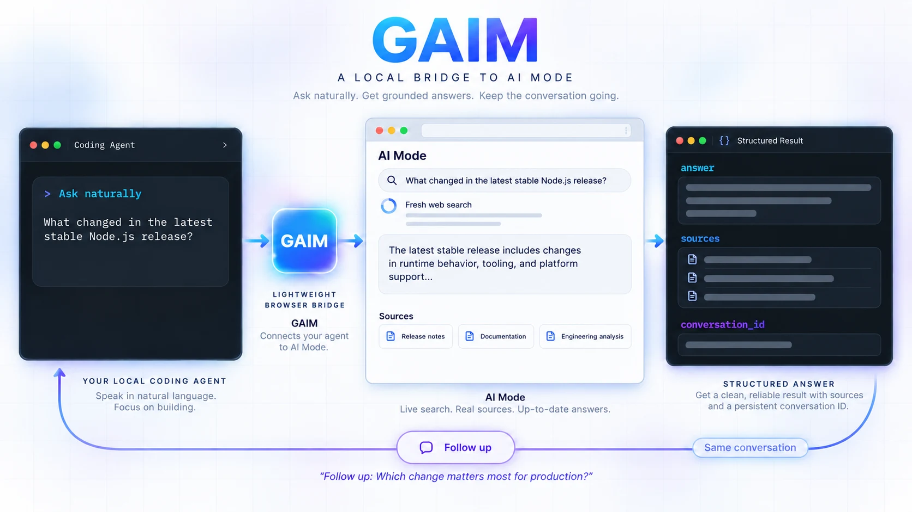

<div align="center">

# GAIM

**G**oogle **AI M**ode for every agent. Pronounced "game."

*Give your agents a research partner. Let them gain an edge at the search game.*

[](https://www.npmjs.com/package/googaim)
[](https://nodejs.org/)
[](LICENSE)

[English](README.md) | [简体中文](README.zh-CN.md)

</div>



The name is deliberately easy to remember: **Google AI Mode becomes GAIM**, pronounced like **game**, with the benefit that agents **gain** a research partner. GAIM gives local agents a natural-language bridge to Google AI Mode. One local conversation core owns one dedicated system-Chrome profile; MCP, ACP, and CLI are thin adapters over it.

> GAIM is an unofficial community project. It is not affiliated with or endorsed by Google. It does not bypass sign-in, account/region eligibility, CAPTCHA, or other human verification.

## Give this to your coding agent

Copy this prompt into any coding agent:

```text
Install the npm package `googaim` globally using Node.js 22 or newer. Do not download Playwright, Puppeteer Chromium, Chrome for Testing, or any other browser: use only an already-installed system Google Chrome. Run `gaim doctor`, then register `gaim mcp` as a local stdio MCP server using this agent's current supported configuration. Tell me if this agent must restart or reload before the new tools appear. Guide me through `gaim login` if the dedicated profile is not signed in. Do not claim success until `gaim_status` runs, one real researched turn succeeds, and a follow-up reuses its `conversation_id`. If this platform or agent is not listed as verified below, say so instead of guessing. Do not expose GAIM over a public URL or weaken browser sandboxing.
```

This follows the same agent-first installation pattern used by popular browser-agent and Agent Skill projects: the agent adapts the stable local command to its own current plugin configuration.

## Quick start

```bash
npm install --global googaim
gaim setup
```

`gaim setup` finds the installed system Google Chrome, tests AI Mode, opens a dedicated local Chrome profile when human action is needed, and verifies readiness after the window closes. `gaim init` prints ready-to-copy MCP and ACP launch declarations using absolute paths.

The first release targets local desktop use: the coding agent, GAIM, and Google Chrome run on the same computer. GAIM uses a minimized, ordinary Chrome window because Google may not make AI Mode available in headless Chrome. GAIM never installs a browser. Set `GAIM_CHROME` only when Chrome is installed in a non-standard location.

## Compatibility status

GAIM does not turn source-code portability into a support claim. A platform or host becomes verified only after a clean install, login hand-off, status call, researched turn, and same-conversation follow-up have all run there.

| Target | Current evidence |
|---|---|
| Linux / WSL with system Chrome | Verified with real Google AI Mode turns |
| Windows native | Implementation and unit tests only; real-browser verification pending |
| macOS | Implementation and unit tests only; real-browser verification pending |
| CLI | Verified end to end on Linux / WSL |
| Generic local stdio MCP | Protocol-tested; named-host verification pending |
| Generic ACP | Protocol-tested; named-host verification pending |
| Codex, Claude Code, OpenCode, Pi, Hermes | Installation recipes and named-host verification pending |
| DevSpace | Not currently supported as a named GAIM provider; upstream generic external-ACP support is required |

Remote servers, containers without a graphical login path, and public network deployment are outside the v0.1 support promise.

## The three operations

- `gaim_turn`: ask a natural-language question. Omit `conversation_id` for a new isolated thread; reuse the returned ID for a follow-up or deliberate multi-agent conversation.
- `gaim_history`: read one conversation's recent transcript without searching.
- `gaim_status`: report Chrome connectivity, Google login/availability, queue depth, and the last error.

Every regular turn tells AI Mode to perform a fresh search. GAIM waits for the completed-answer action toolbar, requires a new Google search request and at least one external source, and otherwise returns an error instead of labeling the answer as researched. Returned links are approximate conversation sources, not sentence-level citations.

## Generic MCP configuration

Most local MCP clients accept this shape:

```json
{
  "mcpServers": {
    "gaim": {
      "command": "gaim",
      "args": ["mcp"]
    }
  }
}
```

If a desktop app cannot find commands from your shell `PATH`, use the absolute `command` and `args` printed by `gaim init`.

## ACP and DevSpace

Run the ACP agent with:

```bash
gaim acp
```

Each ACP session starts with its own isolated GAIM conversation. Later prompts stay in that conversation. Use `/new` to split, `/join <conversation_id>` to share deliberately, `/history` to inspect it, and `/status` to diagnose availability.

An ACP host that supports named external agents can register the command printed under `acp` by `gaim init`. DevSpace's current provider configuration does not expose that generic registration path, so DevSpace is not yet a verified GAIM host. No public endpoint or OAuth proxy is required.

## CLI and end-to-end check

```bash
gaim turn "What changed in the latest stable Node.js release?"
gaim turn "Expand the most important change" --conversation <ID_FROM_FIRST_TURN>
npm run e2e -- "first question" "follow-up question"
```

The first command starts the tiny local daemon automatically. Each conversation keeps its own Chrome tab, turns in the same conversation are serialized, and different conversations can run in parallel. Conversation state and the dedicated Chrome profile live under `~/.local/share/gaim/` unless overridden.

Live conversation tabs remain open for follow-ups. Run `gaim stop` when you want to close GAIM-owned Chrome and release its memory.

## First login

`gaim login` opens the dedicated profile in system Chrome on the same desktop where GAIM runs. Complete any sign-in or human verification directly in that Chrome window.

After closing the login window:

```bash
gaim status
```

Possible explicit states include `NOT_LOGGED_IN`, `AI_MODE_UNAVAILABLE`, and `HUMAN_VERIFICATION`.

## Configuration

| Variable | Default | Purpose |
|---|---|---|
| `GAIM_CHROME` | auto-detected | Existing system Google Chrome executable |
| `GAIM_USER_DATA_DIR` | `~/.local/share/gaim/chrome-profile` | Dedicated persistent Google profile |
| `GAIM_STATE_DIR` | `~/.local/share/gaim` | Conversation state |
| `GAIM_CDP_PORT` | `9224` | Loopback-only Chrome DevTools port |
| `GAIM_GENERATION_TIMEOUT_MS` | `15000` | Bounded answer wait |
| `GAIM_BROWSER_IDLE_MS` | `60000` | Close GAIM-owned Chrome after this idle period when no conversation tab exists; `0` disables |
| `GAIM_MAX_PARALLEL` | `3` | Maximum conversations actively searching at once |
| `GAIM_MIN_SOURCES` | `1` | Minimum external sources per searched turn |
| `GAIM_NO_SANDBOX` | unset | Set to `1` only when the host explicitly requires it |

Selectors and visible labels are centralized near the top of `core.mjs`. GAIM prefers roles, ARIA attributes, and visible text over generated class names.

## Design boundaries

- Local only: a user-only Unix socket or Windows named pipe, plus stdio adapters; no public HTTP server or OAuth setup.
- One owner: only the local core daemon touches Chrome and conversation state.
- Explicit sharing: callers cannot collide unless they deliberately reuse a conversation ID.
- Bounded concurrency: one turn at a time per conversation and at most three active conversations by default.
- Bounded failure: timeouts, explicit error codes, and no CAPTCHA bypass.
- Small install: Node.js, the ACP SDK, and Zod; no Playwright, Puppeteer, bundled browser, or browser download hook.

## Repository map

The repository is deliberately small. Each file has one job:

| Files | Responsibility |
|---|---|
| `core.mjs`, `daemon.mjs`, `client.mjs`, `paths.mjs` | Own Chrome, conversations, persistence, the queue, and the local singleton process |
| `gaim.mjs` | Human-facing CLI: setup, diagnosis, login, status, turns, and shutdown |
| `gaim-mcp.mjs`, `gaim-acp.mjs` | Thin MCP and ACP adapters over the same core |
| `meta.mjs` | Read shared package metadata from its single source |
| `skills/gaim/` | Portable instructions for agents that support Agent Skills |
| `core.test.mjs`, `protocol.test.mjs`, `e2e.mjs` | Unit, protocol, and real-browser verification |
| `package.json`, `package-lock.json` | Reproducible Node.js installation and the public package boundary |
| `README.md`, `LICENSE` | Product explanation and terms |

Run `npm pack --dry-run` to see the exact files that would be published. Tests and contributor documentation stay in GitHub but are intentionally excluded from the installed package.

## Development

```bash
npm install
npm test
npm pack --dry-run
npm run e2e
```

Unit tests use a fake browser and cover isolation, deliberate sharing, speaker identity, idempotency, unknown conversations, per-conversation serialization, and bounded cross-conversation parallelism. The end-to-end test asks once and follows up in the returned conversation using the real Chrome profile.

Ideas, selector updates, bug reports, and pull requests are welcome.

## License

MIT. See [LICENSE](LICENSE).
